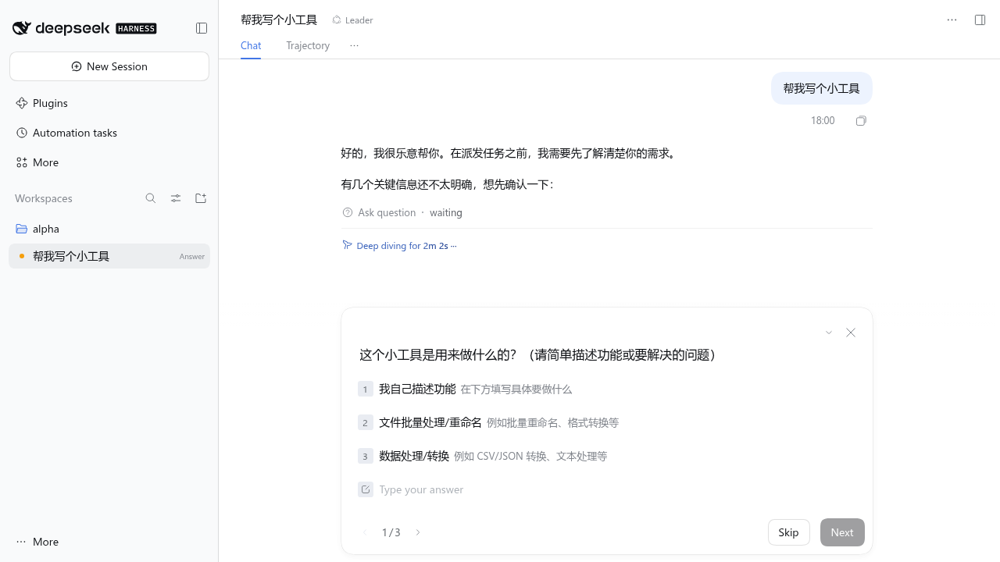
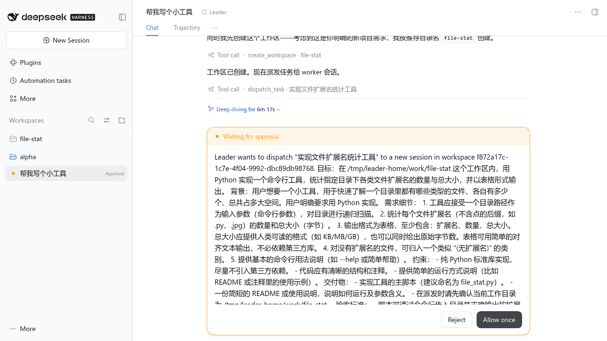
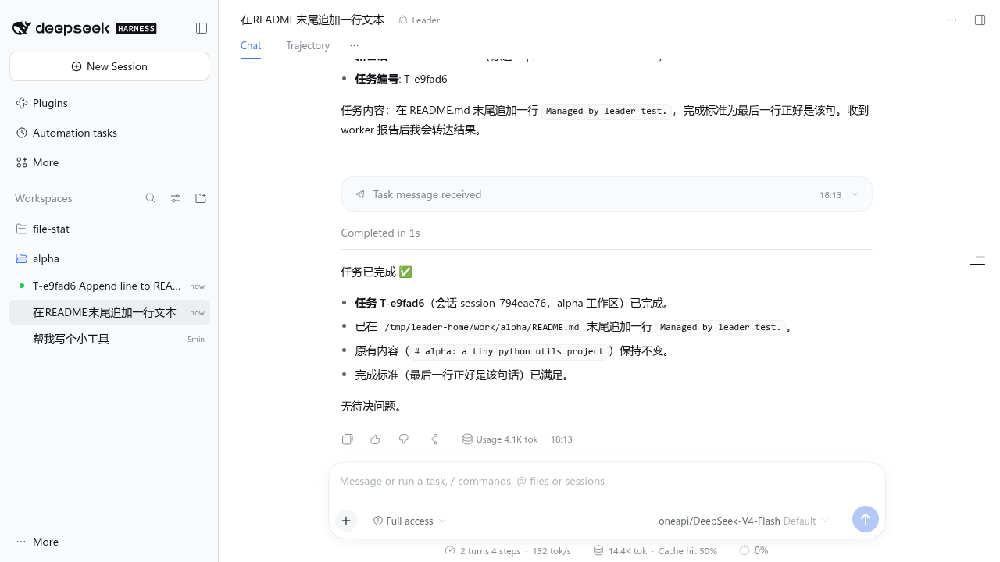
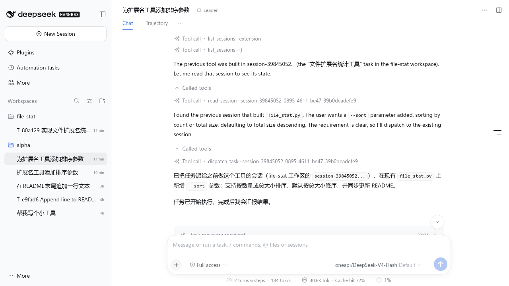
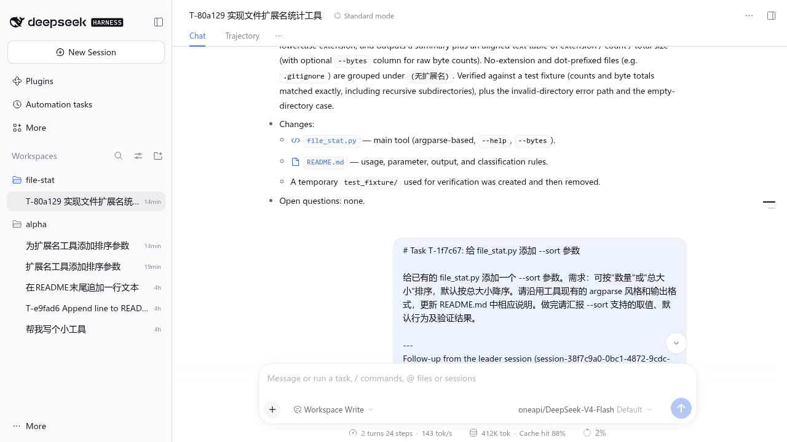

# dsh-super-leader

English | [中文](README.zh.md)

A **Leader** agent preset for DeepSeek Harness. A Leader session does not do the work itself. It talks with you until the request is clear, picks or creates the right workspace and session, hands the task to a worker session, and relays the worker's report back to you.

- **Asks first.** The Leader checks the goal, scope, deliverable, acceptance criteria, and target workspace before dispatching, and asks with `ask_user_question` (one-click options) when any of them is unclear.
- **Coordinator tools only.** A Leader session sees only this plugin's tools and `ask_user_question`. Global tools registered by other plugins (MCP, memory, IM, and so on) are hidden unless you allow them.
- **Approval for write actions.** Creating a workspace, dispatching a task, and cancelling a task show an approval card with the full task brief. When the session's access mode is **Full access**, they run without approval.
- **Knows what each session did.** Before continuing an existing session, the Leader reads its recent requests, replies, todo list, and changed files, so a follow-up brief only says what is new.
- **Automatic reports.** When a worker finishes its turn, its final reply is sent back to the Leader, which summarizes it and turns open questions into questions for you.







When you ask for more work on an existing project, the Leader reads that session first and sends only the next step:





## Install

Requires DeepSeek Harness `>=0.2.2-rc.1 <0.3.0`.

```sh
dsh plugin --profile web add dsh-super-leader
```

Or install the latest code from GitHub: `dsh plugin --profile web add github:RickT34/dsh-super-leader`.

Restart `dsh web`. Then click **New Session**, open the mode menu next to the workspace picker, and choose **Leader**. The preset can only be chosen while a session is still empty, so start a new session for it.

## Tools

| Tool | Approval | What it does |
|---|---|---|
| `list_workspaces` | No | List registered workspaces with their purpose notes |
| `list_sessions` | No | List sessions with workspace, running state, the first line of the latest request, and latest Leader task |
| `read_session` | No | Show what a session actually did: recent requests and replies, earlier requests, todo list, files it changed, Leader tasks sent to it |
| `task_status` | No | Show dispatched tasks and their reports |
| `create_workspace` | Yes | Create a directory under an allowed root (optionally `git clone`, `git init`, or write `AGENTS.md`) and register it as a workspace |
| `dispatch_task` | Yes | Send a task brief to an existing session, or to a new session in a workspace |
| `cancel_task` | Yes | Stop the worker's current turn |

"Approval: Yes" means the call waits for **Allow once** unless the Leader session's permission preset is listed in `fullAccessPresets` (by default `danger-full-access`, shown as **Full access**).

## Configuration

Override the `super-leader` entry in your profile's `cordis.patch.yml`:

```yaml
- id: super-leader
  config:
    workspaceRoots:            # create_workspace may only create directories here
      - ~/Work
    allowTools: []             # global tools the Leader may still use, e.g. dsh_im_return_file
    fullAccessPresets:         # permission presets under which write tools skip approval
      - danger-full-access
    workerPreset: standard     # preset for new worker sessions; empty uses the host default
    reportMaxChars: 4000       # maximum length of a relayed report
```

| Option | Default | Meaning |
|---|---|---|
| `presetId` | `leader` | Agent preset id treated as the Leader |
| `allowTools` | `[]` | Global tools a Leader session may still use |
| `writeTools` | `create_workspace`, `dispatch_task`, `cancel_task` | Tools that require approval |
| `fullAccessPresets` | `[danger-full-access]` | Permission presets that skip approval |
| `workspaceRoots` | `[~/Work]` | Allowed parent directories for new workspaces |
| `workerPreset` | host default | Preset for new worker sessions; must not be the Leader preset |
| `reportMaxChars` | `4000` | Report length limit |
| `ledgerFile` | `$DSH_HOME/super-leader/ledger.json` | Task ledger location |

## How it works

- The plugin declares the `leader` agent preset (Leader tools, `ask_user_question`, time context, and context compaction) and a host plugin.
- For each Leader session, the host plugin denies every global tool that is not in `allowTools`, and keeps doing so as new global tools appear.
- A `tools/pre-execute` gate turns write tools into approval requests unless the session has full access. This is needed because DSH's Full access uses the `never` approval policy, which rejects anything that asks for approval.
- `read_session` builds its digest from the session's event log (through DSH's `sessionQuery` service), so it reflects what the worker did, not just the title.
- `dispatch_task` records the task in the ledger, creates the worker session if needed, and sends the brief with a report format appended. When the worker's turn ends, the last assistant reply of that turn is relayed to the Leader as an agent message.
- The Leader cannot dispatch to itself or to another Leader session.

See [DESIGN.md](DESIGN.md) (Chinese) for details.

## Limitations

- If a worker asks a question or waits for approval in the middle of a turn, the Leader is not notified until that turn ends.
- Tasks that were running when DSH restarted stay `running` in the ledger.
- Prompt sections from other plugins may still mention tools that the Leader cannot see.

## Development

```sh
git clone https://github.com/RickT34/dsh-super-leader.git
cd dsh-super-leader
mkdir -p node_modules/@deepseek-ai
ln -s "$(npm root -g)/@deepseek-ai/dsh/node_modules/@deepseek-ai/schemastery" node_modules/@deepseek-ai/schemastery
npm test
dsh plugin --profile web add "$(pwd)"
```

## License

[MIT](LICENSE)
