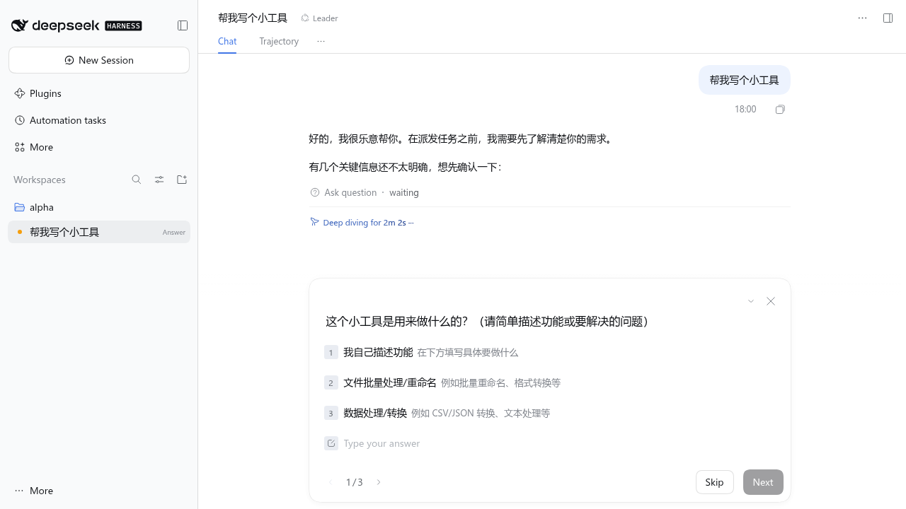

# Super Leader：DeepSeek Harness 的总管会话

[English](README.md) | 中文

**用一个聊天窗口管理你所有的 DSH 会话。** 你只管告诉 Leader 想做什么，它判断这件事属于哪个项目、哪个会话，交给下属会话去做，做完再告诉你结果。

DSH 的每个会话只在一个工作区里干活。项目一多，你就得记住哪个会话在做什么，再来回切换。在 Web 界面里这已经很麻烦，用手机通过 IM 机器人操作就更麻烦，因为一个聊天同一时间只绑定一个会话。Leader 会话是所有会话的统一入口：你只跟 Leader 说话，由 Leader 去跟各个会话打交道。

Leader 自己不写代码、不改文件。它负责把需求问清楚、决定交给谁、派发任务、转达结果；具体工作由下属会话用自己的工具、上下文和模型完成。



## 用起来是什么样

在微信、QQ、Telegram 等任何通过 [`@xmanrui/dsh-im`](https://www.npmjs.com/package/@xmanrui/dsh-im) 接入 DSH 的聊天里：

> **你：** 给 file-stat 那个小工具加个 `--sort` 参数，默认按大小排序。
>
> **Leader：**（读取当初做 file-stat 的会话）那个会话两天前写好了 `file_stat.py` 和 README，现在空闲。在原会话里继续，还是新开一个会话？
> 1. 继续原会话（推荐）
> 2. 在 file-stat 新建会话
>
> **你：** 1
>
> **Leader：** 已作为 T-1f7c67 派给「T-80a129 实现文件扩展名统计工具」，完成后我会汇报。
>
> （几分钟后）
>
> **Leader：** T-1f7c67 完成：新增 `--sort size|count`，默认按大小降序，README 已更新，两种排序都在样例目录上验证过。没有待决问题。

下属收到的任务简报只有四行，因为它本来就了解这个项目。

## 能做什么

- **先问清楚再动手。** 派活前，Leader 会确认目标、范围、交付物、验收标准和目标工作区。缺什么就问什么，并给出可以一键选择的选项，在聊天软件里点一下就能回答。
- **按会话实际做过的事来分派。** 会话标题经常过时。`read_session` 能看到会话最近的请求和回复、待办清单、改过的文件，Leader 据此选对会话，而不是凭标题猜。
- **续派只说新内容。** 已有会话有自己的上下文，续派的简报只写这次新增的要求。新建会话则收到完整的简报：目标、背景、约束、交付物和验收标准。
- **能开新项目。** 遇到新工作，可以在你允许的根目录下新建工作区：空目录、`git clone` 或 `git init`，还可以顺带写好 `AGENTS.md`。
- **做完自动汇报。** 下属一轮结束后，回报自动发给 Leader。Leader 整理后告诉你，并把其中需要你决定的事转成问题问你。你不用自己去盯进度。
- **关键操作由你把关。** 新建工作区、派发、停止任务、更改模型都需要你批准。审批卡片先写明目标工作区、会话和排队状态，再附上简报。切到**完全权限**后直接执行。
- **任务有台账。** `task_status` 列出每个任务的状态和回报。DSH 重启后会对照下属的日志核对任务，不会有任务一直卡在「运行中」，丢失的回报也会明确标出来。
- **按会话选模型。** 可以查看每个会话用的模型、指定新任务用哪个模型、更换下属会话的模型，都不影响你的默认模型。
- **记得你的习惯。** Leader 维护一个普通的 `MEMORY.md`，记下你的偏好、哪个工作区或会话负责什么、你做过的决定，每次对话开始时先读一遍。
- **很省 token。** Leader 从不读代码或命令输出，只看有长度上限的摘要和回报。它的上下文增长很慢，一次请求通常只要一两次模型调用，用小而快的模型就够了。详见[为什么省 token](#为什么省-token)。
- **只做协调。** Leader 会话只能看到自己的工具和 `ask_user_question`，其他插件的工具默认隐藏，需要时由你开放。

## 为什么省 token

真正干活的会话要读文件、跑命令，这些内容都会留在它的上下文里。Leader 不做这些事：

- 它只看分派工作需要的信息：`list_sessions` 的列表、`read_session` 的摘要（回复会截断），以及长度受 `reportMaxChars` 限制的回报（默认 4,000 字符）。
- 一次请求通常只要一两次模型调用：可能先问一个问题，然后派发。
- 它的工具很少，每次请求里固定的部分也就很小。
- 因为只负责沟通和分派，Leader 用小而快的模型就够了；下属会话则各自使用适合任务的模型。

以作者自己的使用为例：两天里，Leader 会话使用 DeepSeek Flash，处理了 79 轮对话、165 次模型调用、31 次派发，最后上下文约 149K token。作为对比，开发本插件所用的 standard 预设会话，31 轮用了 730 次模型调用，上下文达到 577K token。这只是一套环境里的实际数字，不是基准测试，但能看出规律：耗 token 的读代码、改代码都发生在下属会话里，你直接对话的这个会话一直很轻。

## 快速开始

需要 DeepSeek Harness `>=0.2.2-rc.1 <0.3.0`。

```sh
dsh plugin --profile web add dsh-super-leader
```

也可以从 GitHub 安装最新代码：`dsh plugin --profile web add github:RickT34/dsh-super-leader`。

1. 重启 `dsh web`。
2. 点 **新会话**，在工作区选择器旁边的模式菜单里选 **Leader**。预设只能在会话还没有内容时选择，所以要用一个新会话。
3. 选择访问模式。**工作区内修改**下，每次派发都要等你批准；**完全权限**下，需求一旦问清楚，Leader 就直接派发。
4. 告诉它你想做什么。

默认只允许在 `~/Work` 下新建工作区，可以在设置里修改（见[配置](#配置)）。

## 在手机上用（dsh-im）

Leader 很适合作为聊天机器人唯一对接的会话。配合 `@xmanrui/dsh-im` 的设置如下（按 5.10.0 的行为描述）：

1. **把聊天绑定到 Leader。** 新建一个 Leader 会话，再把聊天绑定过去，例如用 dsh-im 的 `/session <ID>`。
2. **打开回报推送。** 设置 → IM机器人 → 通用设置 → 投递 → **会话同步**，勾选 **投递模型回答**，再点 **保存投递设置**。不开的话，Leader 转达下属回报的回复只会出现在 Web 界面里（原因见下文）。
3. **按需开放 dsh-im 的工具。** 例如 `dsh_im_return_file` 让 Leader 把下属产出的文件发到聊天里，`dsh_im_group_history` / `dsh_im_group_file` 让它读取群消息和群文件。在 **Leader 额外可用的工具** 里勾选即可。
4. **决定审批方式。** 完全权限下 Leader 直接派发，在手机上最省事。其他模式下每次派发都要审批；在私聊中、并且投递目标开启了会话同步时，dsh-im 可以把审批推到聊天里。

```yaml
- id: super-leader
  config:
    allowTools:
      - dsh_im_return_file
      - dsh_im_group_history
      - dsh_im_group_file
```

**为什么回报需要「投递模型回答」。** 你在聊天里发消息时，Leader 的回复沿聊天自己的回复链发回去。下属的回报是以 agent 消息的形式到达的，所以 Leader 转达回报的那一轮不是由聊天发起的，dsh-im 默认不推送这类轮次。

**这个开关还会推送什么。** 它是全局开关，作用于所有机器人、所有绑定了聊天的会话。只要某一轮不是由该聊天发起并且成功结束，dsh-im 就把这一轮的最终回答（最后一次工具调用之后的文字）发到聊天里。除了转达的回报，还包括你在 Web 界面给这个会话发消息得到的回答，以及定时任务、问题答复、`subagent-settled` 等内部通知触发的轮次。不会推送：聊天自己发起的轮次、被取消或出错的轮次、工具过程、图片、文件、审批卡片。没有绑定聊天的会话不推送，例如 Leader 新建的下属会话。另一个开关 **镜像 Web 中输入的消息**（`mirrorUserInput`）用不到，可以保持关闭。

**聊天里的审批。** dsh-im 显示的是审批的 `reason`。Leader 的操作会在末尾附一行目标摘要：工作区名称和路径、会话标题和 id（或「新建会话」）、空闲 / 排队 / 注入状态。摘要里不含任务简报。同意和拒绝按审批 id 匹配，与这段文字无关。

如果 Leader 处理回报时向你提问或需要审批，而 dsh-im 无法在这个聊天里显示，就到 Web 界面里回答。在你回答之前，这一轮不会结束，回复也不会推送到聊天。

## 工具

| 工具 | 是否审批 | 作用 |
|---|---|---|
| `list_workspaces` | 否 | 列出已登记的工作区和用途说明 |
| `list_sessions` | 否 | 列出会话、所在工作区、是否运行中、使用的模型、最近一次请求的首行、最近一次 Leader 任务 |
| `read_session` | 否 | 查看会话实际做了什么：最近的请求和回复、更早的请求、待办清单、改过的文件、Leader 派给它的任务 |
| `list_models` | 否 | 列出可用的服务商和模型、每个模型的推理强度，以及主机默认模型 |
| `task_status` | 否 | 查看已派发的任务、回报，以及回报是已送达、已恢复还是已丢失 |
| `read_memory` | 否 | 读取 Leader 工作目录下的 `MEMORY.md` |
| `write_memory` | 否 | 向 `MEMORY.md` 追加内容或整体重写（`mode: "replace"`）；最多 32,000 字符 |
| `create_workspace` | 是 | 在允许的根目录下新建目录（可选 `git clone`、`git init`、`AGENTS.md`）并登记为工作区 |
| `dispatch_task` | 是 | 把简报发给已有会话，或在指定工作区新建会话再发；可指定模型 |
| `set_session_model` | 是 | 更改已有下属会话使用的模型 |
| `cancel_task` | 是 | 停止下属会话当前的轮次 |

「是」表示调用会等你点 **允许一次**，除非 Leader 会话的权限预设在 `fullAccessPresets` 里（默认是 `danger-full-access`，即**完全权限**）。哪些工具需要审批由 `writeTools` 决定。旧版本里保存过的列表会保留，并且总会加上 `set_session_model`。

## 记忆

**内置记忆。** `MEMORY.md` 放在打开 Leader 会话时所在的目录。Leader 在对话开始时读一次，并把长期有效的信息写进去：你的偏好、哪个工作区或会话负责什么、你做过的决定。它不记任务进度、回报或密钥。这是普通的 Markdown 文件，你可以自己编辑或删除，写入不需要审批。

**其他记忆插件。** 也可以让 Leader 使用你已有的记忆插件。在 profile 中启用该插件，再在 **Leader 额外可用的工具** 里勾选它的工具（或把工具名加入 `allowTools`）。不会自动开放任何工具。以 Mnemon 为例：

```yaml
- id: super-leader
  config:
    allowTools:
      - mnemon_runtime_memory
      - mnemon_document_search
```

请合并到你已有的工具列表里。开放工具只是让 Leader 能看到它；存储、范围、权限、上下文快照和使用说明仍由记忆插件自己负责，不要把它的主机服务挂进 Leader 预设。以 Mnemon 为例，`mnemon_recall` 还需要当前 View 提供一个活动且可搜索的 Memory Space，只开放工具并不会创建它。如果希望记忆写入也经过 Leader 审批，把工具名加入 `writeTools`。

## 配置

在 Web 界面打开 **插件 → Super Leader**。修改后立即对 Leader 会话生效，已打开的会话也一样。表单修改的是 profile 的 `cordis.patch.yml` 里 `super-leader` 这一项，所以也可以直接编辑文件：

```yaml
- id: super-leader
  config:
    workspaceRoots:            # create_workspace 只能在这些目录下创建
      - ~/Work
    allowTools: []             # Leader 额外可用的全局工具
    fullAccessPresets:         # 这些权限预设下写操作免审批
      - danger-full-access
    workerPreset: standard     # 新建下属会话使用的预设；留空则用主机默认
    reportMaxChars: 4000       # 转达回报的最大长度
```

| 配置项 | 默认值 | 含义 |
|---|---|---|
| `workspaceRoots` | `[~/Work]` | 新建工作区允许的父目录 |
| `workerPreset` | 主机默认 | 新建下属会话的预设，不能是 Leader 预设 |
| `fullAccessPresets` | `[danger-full-access]` | 免审批的权限预设 |
| `writeTools` | `create_workspace`、`dispatch_task`、`cancel_task`、`set_session_model` | 需要审批的工具；总是包含 `set_session_model` |
| `allowTools` | `[]` | Leader 额外可用的全局工具 |
| `reportMaxChars` | `4000` | 回报长度上限 |
| `presetId` | `leader` | 视为 Leader 的预设 id（只能改文件，需要重启） |
| `ledgerFile` | `$DSH_HOME/super-leader/ledger.json` | 任务台账位置（只能改文件，需要重启） |

## 工作原理

- 插件提供一个 `leader` 预设：Leader 工具、`ask_user_question`、`AGENTS.md`/`CLAUDE.md` 指令（加载方式与 standard 预设相同）、时间上下文和上下文压缩。其余工作由一个主机插件完成。
- 对每个 Leader 会话，主机插件隐藏所有不在 `allowTools` 里的全局工具，之后新注册的工具也一样。
- 审批闸门把写类工具变成审批请求，完全权限的会话除外。DSH 自带的完全权限策略会直接拒绝所有需要审批的操作，所以由插件自己判断访问模式。
- `read_session` 根据会话的事件日志生成摘要，反映的是下属实际做了什么，而不只是标题。
- `dispatch_task` 记录任务，需要时新建下属会话，发送附带回报格式的简报。下属这一轮结束后，这一轮的最后一条回复以 agent 消息的形式发给 Leader。
- 模型更改只针对单个会话：写入的是模型选择器同样使用的 `model/selection` 事件，但不改主机默认模型。目标会话正在运行时，`dispatch_task` 不允许同时改模型。
- Leader 不能把任务派给自己，也不能派给其他 Leader 会话。

更多细节见 [DESIGN.md](DESIGN.md)。

## 任务恢复

插件启动、恢复时，以及每次调用 `task_status` 时，都会对照下属的轮次日志核对台账。已结束的轮次恢复真实的最终状态；原轮次仍在运行、或请求仍在排队的任务继续跟踪；没有结束记录就停了的轮次、被移除的请求、找不到的会话标为 `interrupted`。暂时读不到日志时，任务保持未结束并显示 `reconciliation_error`，之后再核对。

`task_status` 对每个任务显示 `report_state` 和 `report_missing`。当时没送到 Leader、后来从下属日志里找回的回报标为 `recovered`；完全没有回报的标为 `lost`。不会重跑任务，也不会补发旧回报。

## 已知限制

- 下属在一轮中途提问或等待审批时，Leader 要等这一轮结束才会知道。
- 中断的任务不会自动继续执行。
- 其他插件的系统提示可能仍会提到 Leader 看不到的工具。

## 开发

```sh
git clone https://github.com/RickT34/dsh-super-leader.git
cd dsh-super-leader
mkdir -p node_modules/@deepseek-ai
ln -s "$(npm root -g)/@deepseek-ai/dsh/node_modules/@deepseek-ai/schemastery" node_modules/@deepseek-ai/schemastery
npm test
dsh plugin --profile web add "$(pwd)"
```

## 许可证

[MIT](LICENSE)
